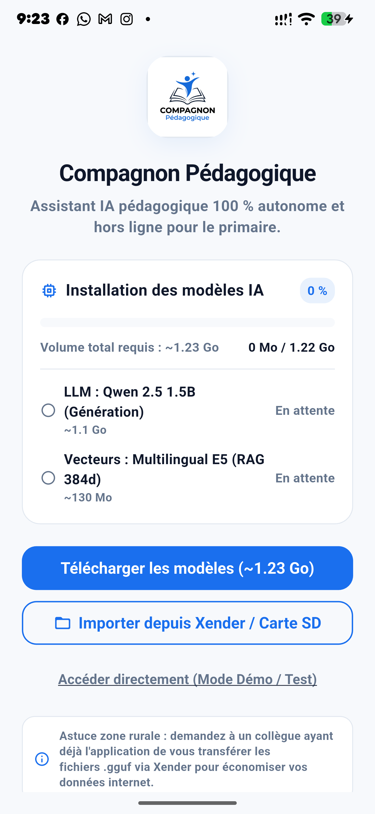

# Compagnon Pédagogique

**Branche :** `main`. Une seule version de l'app : 100 % locale, sans backend.

Compagnon Pédagogique est un assistant IA conçu pour les enseignants du primaire en milieu rural. L'application fonctionne entièrement hors ligne sur le smartphone : aucun compte, aucun serveur distant, aucune donnée transmise.

- **Nom affiché :** `Compagnon Pédagogique`.
- **Identifiant :** `com.compagnon.pedagogique`.
- **Éditeur :** Ismaël — djiboismaelzeno@gmail.com.
- **Moteur :** Inférence locale (`flutter_edge_ai` / `llamadart`) + recherche vectorielle SQLite (`sqlite_vec`).

## Plateformes

| Plateforme | État | Détails |
| :--- | :--- | :--- |
| **Android** | Cible principale | APK / AAB `arm64-v8a` (API 24+, compatible pages mémoire 16 Ko / Android 15+) |
| **Linux** | Développement / Tests | Exécution des tests unitaires, widgets et analyse statique |

> **Prérequis matériel :** les modèles locaux (`~1,23 Go` sur disque) nécessitent au moins `1,5 Go` d'espace libre à l'installation et un appareil disposant idéalement de `4 Go` de RAM ou plus pour l'inférence fluide de `Qwen 2.5 1.5B`.

## Modèles IA et moteur local

L'application embarque une base SQLite pré-vectorisée (`assets/db/programmes_scolaires.db`) et s'appuie sur deux modèles au format GGUF stockés localement sur l'appareil (non versionnés dans Git) :

- **Génération (LLM) :** `qwen2.5-1.5b-instruct-q4_k_m.gguf` (`~1,1 Go`), configuré en session native sans double balisage ChatML (`temperature: 0.3`, `topP: 0.8`, `topK: 20`, fenêtre `2048` tokens).
- **Vectorisation (RAG) :** `multilingual-e5-small-q8_0.gguf` (`~130 Mo`, vecteurs 384 dimensions).

### Extension native `sqlite_vec`

Les bibliothèques natives précompilées `libsqlite_vec.so` (`arm64-v8a`, `armeabi-v7a`, `x86_64`) sont alignées sur `64 Ko` (`-Wl,-z,max-page-size=65536`) pour la conformité Android 15+ (pages 16 Ko) et chargées via `packages/sqlite_vec/`. `scripts/build_sqlite_vec.sh` permet de les recompiler à l'identique avec Clang du NDK Android.

### Identité visuelle

Le logo (`assets/images/logo.png`), les icônes Android (`mipmap-*`) et les polices **Roboto** / **Roboto Mono** (`assets/google_fonts/`) sont embarqués localement afin de garantir un rendu identique sans accès réseau.

## Fonctionnalités

### Gestion des modèles hors ligne

- **Contrôle pré-vol du stockage :** vérification POSIX (`statvfs` via FFI) imposant au moins `1,5 Go` d'espace libre avant tout téléchargement ou import, sans bloquer l'utilisateur lorsque les modèles sont déjà installés.
- **Téléchargement avec reprise :** gestion en arrière-plan via `background_downloader`.
- **Import local sans Internet :** importation de fichiers `.gguf` partagés via Xender ou carte SD (`file_picker` / SAF, sans permission `MANAGE_EXTERNAL_STORAGE`), avec vérification stricte du magic number GGUF (`0x47 0x47 0x55 0x46`) et écriture atomique (`.tmp` puis renommage).

### Assistant pédagogique et RAG local

- **Cadrage en une question à la fois :** si la demande est imprécise, l'assistant propose des puces interactives (`CP` à `CM2`, `Double niveau`, matières, durées) utilisables sans clavier virtuel.
- **Recherche documentaire locale (RAG) :** interroge `programmes_scolaires.db` via `sqlite_vec` (KNN) avec repli lexical, et affiche les extraits retenus dans une pastille compacte de la barre supérieure sans décalage de mise en page.
- **États de génération dynamiques :** indicateur minimaliste pendant la recherche RAG et le chargement du modèle, streaming fluide avec curseur respiratoire, retours haptiques discrets et apparition animée des actions finales (**Exporter en PDF**, **Copier le texte**) uniquement à la fin de la génération.
- **Rendu structuré :** mise en forme Markdown par sections (`Objectifs`, `Déroulement`, `Exercices`, `Corrigé`) et rendu des formules mathématiques LaTeX.

### Export et historique PDF

- **Export hors ligne :** génération de fiches propres (sans glyphes non supportés) enregistrées localement et copiées en miroir dans `Documents/CompagnonPedagogique/` pour une récupération directe par câble USB sur ordinateur.
- **Historique consultable :** recherche instantanée par titre, filtres temporels (*Toutes*, *Aujourd'hui*, *Cette semaine*), ouverture directe dans la visionneuse du téléphone (`open_filex`), impression, partage et suppression coordonnée (copie interne + copie publique).

### Apparence et lisibilité

- **Thème clair « EdTech Lumineux » :** fond `#F7F9FC`, surfaces blanches arrondies, accent bleu royal `#1A6FEE`, statut hors ligne vert `#16A34A`.
- **Mode Plein Soleil (WCAG AAA) :** commutateur rapide dans l'en-tête basculant vers un contraste maximal (fond blanc pur, typographie noire, bordures nettes) pour la lecture en extérieur ou en classe très lumineuse.

## Technologies utilisées

- **Framework :** Flutter, Dart
- **Architecture :** Clean Architecture (feature-first), `flutter_bloc` (Cubit), `get_it`
- **Inférence IA locale :** `flutter_edge_ai`, `flutter_edge_ai_llama` (`llamadart`)
- **Base vectorielle :** `sqflite`, `sqlite_vec` (FFI)
- **Interface chat :** `flutter_ai_toolkit` (`LlmChatView`)
- **Téléchargement et fichiers :** `background_downloader`, `file_picker`, `path_provider`
- **Export PDF :** `pdf`, `printing`, `open_filex`, `share_plus`

## Développement local

```bash
# Récupération des dépendances
flutter pub get

# Analyse statique et suite de tests (84 tests unitaires et widgets)
flutter analyze
flutter test

# Exécution sur un appareil Android connecté
flutter run

# Tests d'intégration de bout en bout sur appareil
flutter test integration_test/app_e2e_test.dart -d <device_id>
```

## Aperçu

Capture réalisée sur un Pixel 7 Pro (Android 17, pages mémoire 16 Ko).

| Installation des modèles hors ligne |
| :---: |
|  |

## Prochaines étapes

- **Enrichissement des programmes :** étendre `programmes_scolaires.db` avec des programmes scolaires complets (CP–CM2) et un parcours guidé *Bibliothèque officielle + adaptation IA*.
- **CI/CD et release open source :** workflow GitHub Actions (`flutter analyze`, `flutter test`, audit ELF 16 Ko), licence Apache 2.0, `CONTRIBUTING.md`, règles Proguard/R8 et signature Release Android.
